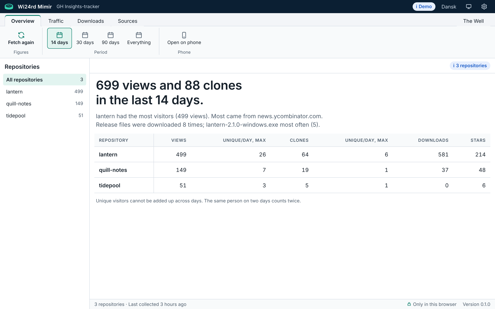
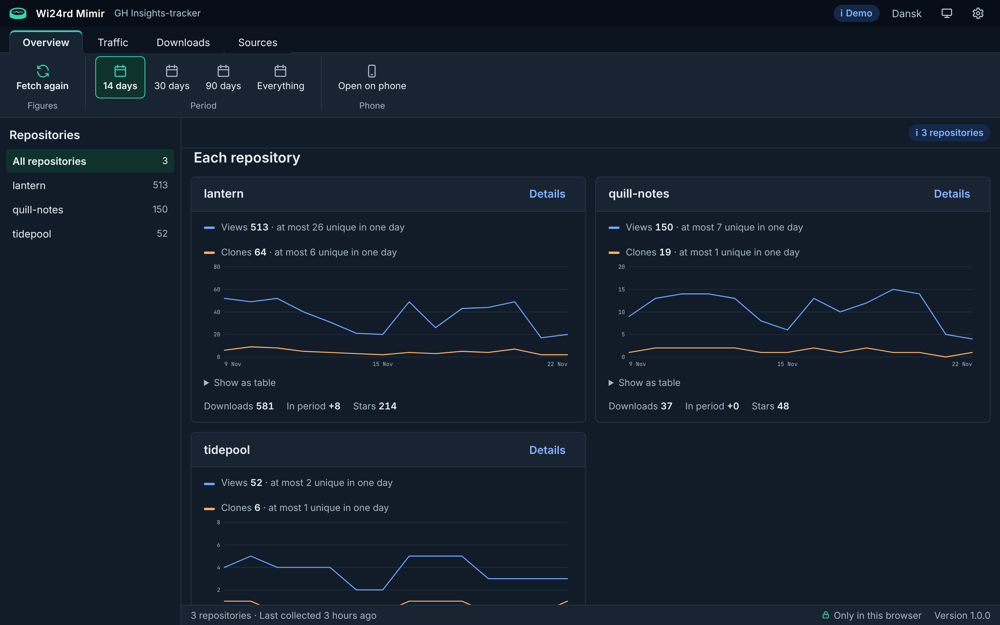
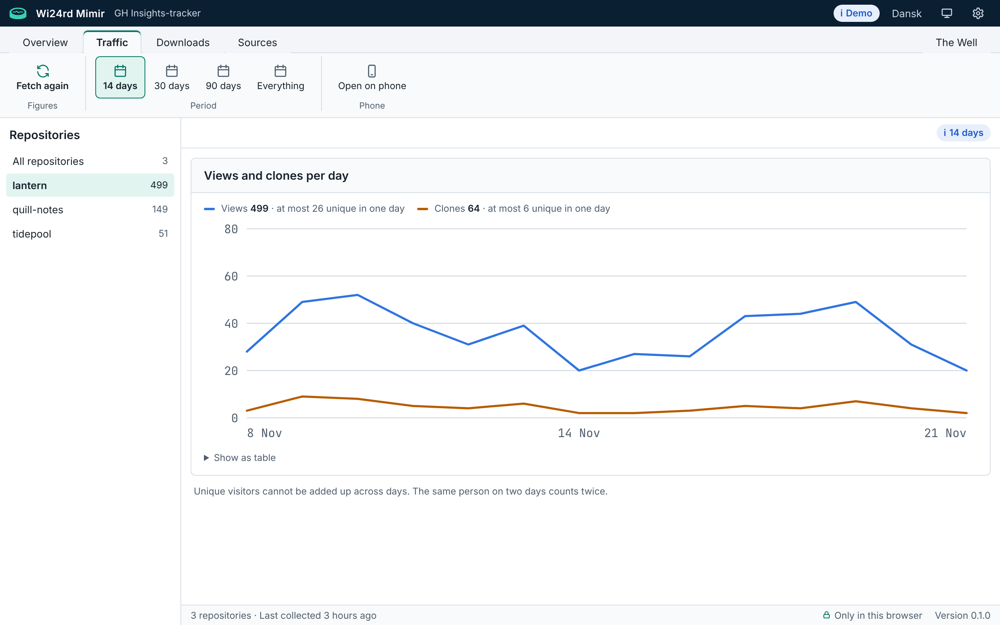
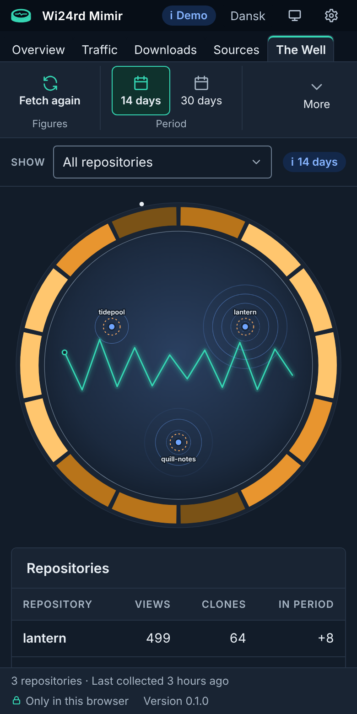
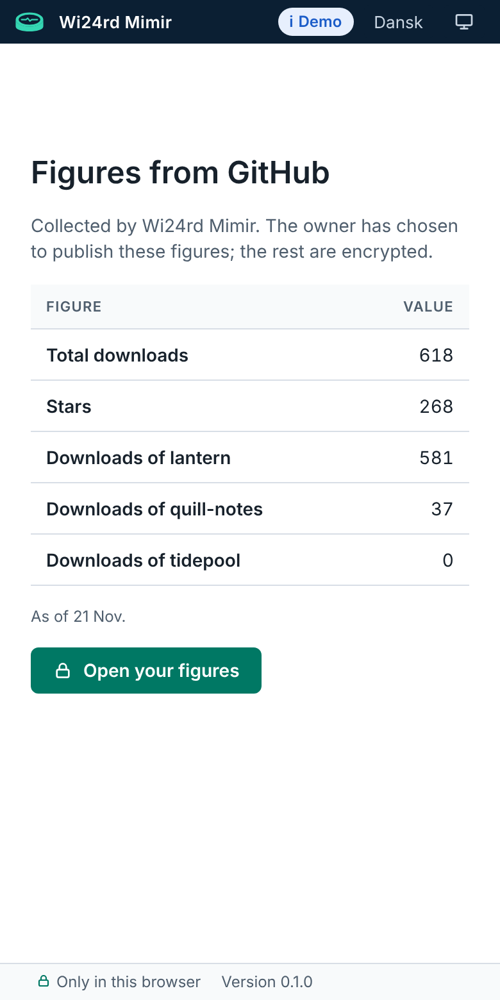
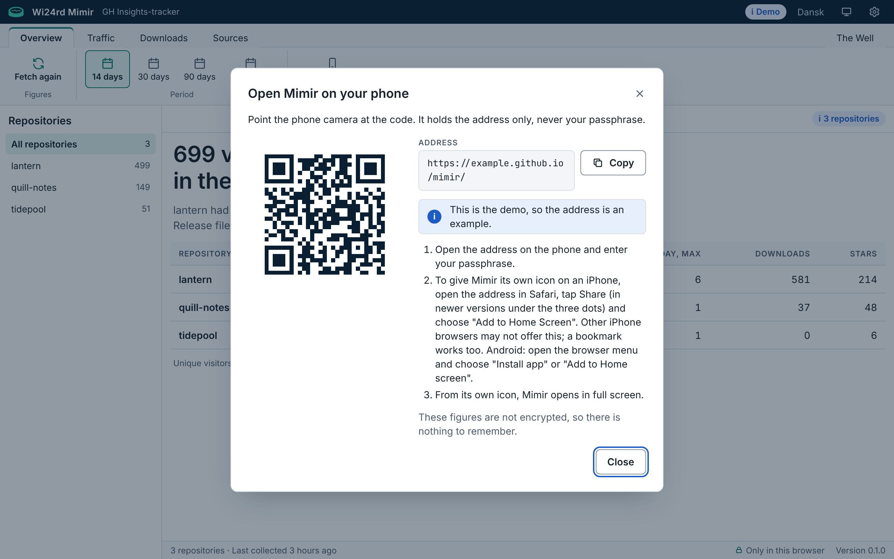

<h1>
  <picture>
    <source media="(prefers-color-scheme: dark)" srcset="assets/mimir-banner-dark.jpg">
    
  </picture>
</h1>

Gemmer historikken for din GitHub-trafik og dine release-downloads, i din egen konto.

GitHub viser kun trafikken for et repository for de seneste 14 dage, og viser
ikke, hvor ofte en release-fil er hentet. Mimir henter begge dele to gange i
døgnet med en GitHub Actions-workflow og gemmer dem i en `data`-gren i din egen
kopi af dette repository. Intet sendes til Wi24rd eller til nogen tredjepart.

**Status: version 1.0.1, i daglig brug hos forfatteren.** Kørt i virkeligheden:
installationsscriptet og den guidede opsætning på en frisk kopi, indsamlingen,
dashboardet på GitHub Pages og på en iPhone, mærkerne (badges) og testene på
GitHub. Endnu ikke bevist: at vagten holder GitHub fra at sætte tidsplanen på
pause, for det tager 60 dage at se. Ikke prøvet: Android, Safari selv og Mimir
som app på hjemmeskærmen. Se [`asewave/`](asewave/) for beviserne bag hvert
punkt, og [`CHANGELOG.md`](CHANGELOG.md) for, hvad hver version indeholder.

<picture>
  <source media="(prefers-color-scheme: dark)" srcset="assets/screens/overview-dark.png">
  
</picture>

*Alle billeder på denne side viser demoen med opdigtede tal. Billederne er taget med engelsk sprog; dashboardet findes også på dansk.*

**[Prøv demoen](https://wi24rd-com.github.io/mimir/?demo)** i din browser, eller se
[den side, en besøgende møder](https://wi24rd-com.github.io/mimir/?demo=front).
Tallene er opdigtede og laves i din browser; intet hentes.

**[Se det i drift](https://wi24rd-com.github.io/mimir-wi24rd/)**: Wi24rds egne tal, indsamlet af Mimir og vist
åbent. Dette mærke er et af dem: [](https://wi24rd-com.github.io/mimir-wi24rd/)

## Et kig rundt

Mimir kører i en browser, på enhver computer og på en telefon.

| En graf for hvert repository | Ét repository over tid |
|---|---|
|  |  |
| Under Brønden på startsiden, til at rulle igennem. | Visninger og kloninger pr. dag, gemt ud over GitHubs 14 dage. |

| På en telefon | Det, en besøgende ser | Åbn på telefon |
|---|---|---|
|  |  |  |
| Lys og mørk, engelsk og dansk. | Kun det, du har valgt at offentliggøre. Resten er krypteret. | En QR-kode med adressen og intet andet. |

## Hvad den indsamler

| Tal | Kilde | Hvad du får |
|---|---|---|
| Visninger og kloninger | Traffic API | Ét tal pr. dag, gemt ud over 14 dage |
| Henvisninger og populære stier | Traffic API | GitHubs top 10 for de seneste 14 dage, gemt én gang i døgnet |
| Release-downloads | Releases API | Tælleren pr. fil, gemt når den ændrer sig |
| Stjerner, forks, watchers | Repository API | Gemt når de ændrer sig |

Unikke besøgende kan ikke lægges sammen på tværs af dage. GitHub oplyser dem
kun pr. dag, og den samme person på to dage tæller to gange.

## Tre tilstande

Sæt `visibility` i [`mimir.json`](mimir.json).

| Tilstand | Hvem kan læse tallene | Repository |
|---|---|---|
| `encrypted` (standard) | Den, der har adgangsfrasen | Offentligt, indholdet krypteret |
| `public` | Alle | Offentligt |
| `private` | Dig | Privat |

I tilstanden `encrypted` gemmes alt som AES-256-GCM-filer. Nøglen afledes af
din adgangsfrase med PBKDF2-SHA256 (600.000 runder). Filnavnene røber ikke,
hvilke repositories du følger. Det, der stadig kan ses: at der findes en
tracker, hvornår den kører, og nogenlunde hvor meget data den rummer.

At skifte fra en åben tilstand til `encrypted` fjerner ikke de tal, der
allerede ligger i git-historikken. Mimir afviser det skift, medmindre du selv
beder om det.

## Adgang

Trafiktal kræver rettigheden "Administration: read". Den indbyggede
Actions-token kan ikke få den. I stedet for en personlig adgangstoken med lang
levetid registrerer opsætningen en GitHub App, der tilhører dig, med den ene
læserettighed. Hver kørsel beder om en token, der udløber efter en time.

## Opsætning

Kræver git, [GitHub CLI](https://cli.github.com) (logget ind med
`gh auth login`) og Node.js 20 eller nyere. Opsætningen stiller sine spørgsmål
i terminalen og klarer resten. Der er tre måder at starte den på; de ender
samme sted.

**Med installationsscriptet.** Det opretter din kopi, kloner den og starter opsætningen:

```
curl -fsSLO https://raw.githubusercontent.com/wi24rd-com/mimir/main/install.sh
less install.sh     # læs det først; det er kort
sh install.sh
```

**Med GitHub CLI**, på to linjer:

```
gh repo create my-mimir --template wi24rd-com/mimir --public --clone
cd my-mimir && node src/setup.mjs
```

**I hånden.** Klik på **Use this template** øverst på repositoryets side, opret
dit repository, klon det, og kør `node src/setup.mjs` i klonen.

Gør repositoryet offentligt, hvis du vil have dashboardet på GitHub Pages og
mærker; dine tal kan stadig være krypterede. Et privat repository holder alt
for dig selv, og dashboardet kører så kun på din computer.

Opsætningen fører dig derefter igennem det:

1. Hvilke repositories der skal følges, valgt fra en liste over dine egne.
2. Hvordan tallene gemmes: krypteret, offentligt eller privat.
3. Om nogen tal offentliggøres. Ingen bliver det, medmindre du vælger dem.
4. Den viser den `mimir.json`, den har lavet, og gemmer, committer og pusher den, når du siger ja.
5. Den opretter din GitHub App og gemmer dens nøgle. I tilstanden `encrypted`
   laver den din adgangsfrase og viser den én gang.
6. Den slår GitHub Pages til og giver dig adressen på dit dashboard.
7. Den starter den første indsamling og venter på den. Viser det sig, at appen
   ikke er installeret, siger den det, giver linket og prøver igen, når du er klar.

Opsætningen kan køres igen. Det, der allerede er gjort, springes over, så den
gør også en afbrudt opsætning færdig. Vil du ændre indstillingerne senere, så
ret `mimir.json`, eller brug indstillingsdialogen i dashboardet.

Brug skabelonen, ikke en fork. Hver kopi har sine egne tal i sin egen
`data`-gren, og intet indsamles i en kopi, før opsætningen har kørt der. En
kopi følger ikke dette repository af sig selv; se [Opdatering](#opdatering).

Du bekræfter to gange i browseren: én gang for at oprette appen, og én gang for
at vælge de repositories, den må læse. Appens nøgle går direkte ind i
repositoryets secrets. Den skrives ikke til disken og vises ikke på skærmen.
Appen får navn efter din konto og repositoryet
(`mimir-<konto>-<repository>`), så en kopi nummer to på samme konto får sin
egen app.

## Opdatering

I din klon:

```
node src/update.mjs --check    # findes der en nyere version?
node src/update.mjs            # tag den nyeste version
node src/update.mjs v1.2.0     # eller en version, du selv nævner
```

Den henter versionen fra dette repository og erstatter Mimirs egne filer:
`src/`, `docs/`, `test/`, `tools/`, `install.sh` og de to workflows. Din
`mimir.json`, din README, dine tal i `data`-grenen og en fil med eget domæne
(`docs/CNAME`) røres ikke. Intet committes. Du ser på ændringen
(`git diff --cached --stat`), kører `npm test`, og committer og pusher selv;
`git reset --hard` tager det tilbage. En ny hovedversion afvises, indtil du
beder om den med `--major`.

Versionerne er taggede releases af dette repository. Fra 1.0.0 læser en nyere
1.x-version `mimir.json` og `data`-grenen fra en ældre, uden at du skal gøre
noget. En test (`test/format.test.mjs`) gemmer filer skrevet af 0.1.0 for at
holde det løfte.

## Se dine tal

I din klon:

```
node src/show.mjs          # et resumé i terminalen
node src/dashboard.mjs     # dashboardet, kun vist på denne computer
```

Begge læser `data`-grenen i din klon. I tilstanden `encrypted` spørger de om
din adgangsfrase; dashboardet dekrypterer i browseren og har kun adgangsfrasen
i den fanes hukommelse. Tilføj `--demo` til en af kommandoerne for at prøve med
opdigtede tal, og `--lang da` for dansk i terminalen. `--front` viser den side,
en besøgende ville møde på GitHub Pages.

Dashboardet er på engelsk og dansk, lyst og mørkt, og virker på en telefon. Det
åbner på Oversigt: totalerne i en sætning, og derefter Brønden, som tegner dine
tal som ét billede (en sten pr. dag langs kanten og et punkt pr. repository på
vandet) med en tabel over tallene ved siden af. Under den har hvert repository
sin egen kasse med en graf over visninger og kloninger, til at rulle igennem.
Tre faner mere rummer detaljerne (Trafik, Downloads, Kilder), og et filter
snævrer det hele ind til ét repository. En indstillingsdialog skriver en ny
`mimir.json`, som du selv gemmer på GitHub. Siden kan ikke selv ændre dit
repository. Den henter kun fra GitHub: dine tal, og, når intet er indsamlet i
36 timer, ét spørgsmål om, hvorvidt indsamlingens workflow stadig er slået til.
Tilføj `?demo` til adressen på GitHub Pages for at se demoen.

Det er bygget med [Wi24rd UI Kit 2](docs/kit/), det designsystem, Wi24rds
programmer deler, kopieret uændret ind i `docs/kit/`.

## På din telefon

Prøvet på GitHub Pages og i browseren på en iPhone, og i Chrome, Firefox og
WebKit (motoren i Safari) i skrivebords- og telefonstørrelse. Ikke prøvet:
Android, Safari selv og "Føj til hjemmeskærm". Se [`asewave/`](asewave/).

Når repositoryet er offentligt, og GitHub Pages viser mappen `docs/`, har
dashboardet sin egen adresse. Slå det til under Settings, Pages: deploy fra
grenen `main`, mappen `/docs`. "Åbn på telefon" i dashboardet viser en QR-kode
med den adresse og intet andet. På telefonen giver "Føj til hjemmeskærm"
(iPhone) eller "Installer app" (Android) Mimir sit eget ikon og åbner den i
fuld skærm. Den kræver forbindelse; intet gemmes til brug uden net.

**Det, en besøgende ser.** I tilstanden `encrypted` møder en besøgende en
forside med de tal, du har valgt at offentliggøre, hvis der er nogen, og en
knap, der fører til låsen. Alt andet forbliver krypteret. I tilstanden `public`
ser en besøgende hele dashboardet.

**Husk på denne enhed.** Slået fra, medmindre du sætter hak på låseskærmen. Der
er to måder:

- *Med et tjek*: Mimir opretter en passkey på enheden, og din adgangsfrase
  gemmes krypteret under en hemmelighed, som passkeyen kun udleverer efter Face
  ID, fingeraftryk eller enhedens kode. Ikke alle telefoner og
  adgangskodeprogrammer kan dette; Mimir siger det og husker intet, når de ikke kan.
- *Uden et tjek*: adgangsfrasen gemmes krypteret under en nøgle, som browseren
  ikke udleverer. Enhver med den oplåste enhed i hånden kan åbne tallene.

I begge tilfælde hører det, der huskes, til webadressen, ikke til Mimir. På
GitHub Pages deler alle sider under én konto adressen `<konto>.github.io`, så
en anden Pages-side under din konto kan nå det. Brug det kun, når siderne på
den adresse er dine egne. "Glem denne enhed" fjerner det; en passkey bliver i
dit adgangskodeprogram, indtil du sletter den der.

Browsere afviser passkeys på en numerisk adresse. Det lokale dashboard svarer
også på `http://localhost:<port>/`, hvor de virker.

## Mærker og offentliggjorte tal

`public_badges` i `mimir.json` opregner, hvad der offentliggøres åbent, i alle
tilstande: `total_downloads`, `stars`, `repo_downloads` (ét tal pr. repository)
og `well`. De tre første er enkelte tal med hvert sit mærke. `well` sætter
Brønden på forsiden og offentliggør det, den tegnes af: visninger pr. dag, og
visninger, kloninger og downloads pr. repository, for de seneste 14 dage. Det
er tal, GitHub kun viser til ejeren, og når de først er offentliggjort, bliver
de i `data`-grenens historik. Besøgende, henvisninger og sider offentliggøres
aldrig. Hver indsamling skriver én lille JSON-fil pr. tal til `badges/` på
`data`-grenen, fjerner filerne for de tal, du ikke længere har på listen, og
skriver `public.json` til forsiden.

Indstillingsdialogen giver Markdown og HTML til hvert mærke, klar til at sætte
ind i en README. Billedet tegnes af [shields.io](https://shields.io), en
tjeneste uden for GitHub, som læser tallet fra din `data`-gren; læsere af din
README henter billedet derfra. Repositoryet skal være offentligt.

## Begrænsninger

- GitHub slår planlagte workflows fra i et offentligt repository efter 60 dage
  uden aktivitet, og Mimir committer kun til `data`-grenen. En workflow, der er
  slået fra, kan ikke selv melde det, så Mimir værner mod det på tre måder:
  - Et lille job slår Collect-workflowen til igen ved hver kørsel, hvilket skal
    holde GitHub fra at sætte den på pause. Det er ikke bevist over fulde 60 dage.
  - Efter 45 dage uden et commit på hovedgrenen åbner en indsamling én issue,
    "Mimir: GitHub may pause collection soon", så GitHub giver dig besked, mens
    der er tid. Den lukker sig selv efter næste commit.
  - Når intet er indsamlet i 36 timer, spørger dashboardet og terminalvisningen
    GitHub, om workflowen er slået fra, siger det, og peger på "Enable
    workflow". GitHub gemmer trafikken i 14 dage, så ingen tal går tabt, når
    det sker inden for to uger.
- Ikke prøvet på Android, i Safari selv eller som app på hjemmeskærmen.
- En mislykket indsamling åbner en issue i repositoryet. Den næste vellykkede lukker den.
- Commits på `data`-grenen bærer kun dagen, ikke klokkeslættet. Listen over
  kørsler under Actions viser stadig, hvornår hver indsamling kørte.
- Vedligeholdt af én person i fritiden. Intet løfte om support, ingen svartider.

## Udvikling

```
npm test
```

De samme test kører på GitHub ved hvert push til hovedgrenen (`.github/workflows/test.yml`).

Ingen afhængigheder. Bygget med [ASEWAVE](https://asewave.org).

[CONTRIBUTING.md](CONTRIBUTING.md) fortæller, hvordan du sender en ændring, og
[SUPPORT.md](SUPPORT.md), hvor du henvender dig med et spørgsmål. Begge er på engelsk.

## Licens

Apache License 2.0. Se [`LICENSE`](LICENSE) og [`NOTICE`](NOTICE). Skrifterne i
`docs/kit/fonts/` er under SIL Open Font License 1.1.

[English](README.md)
