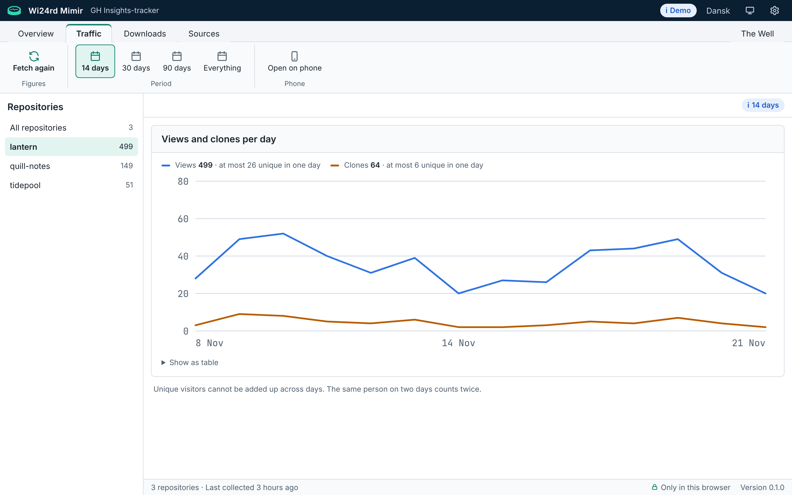
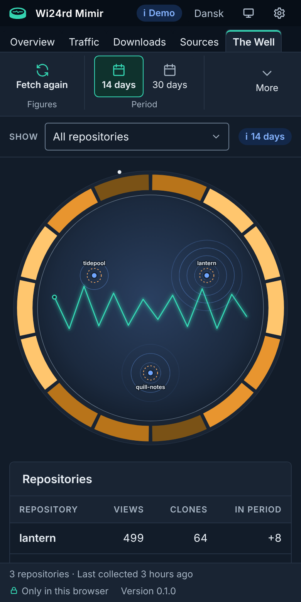
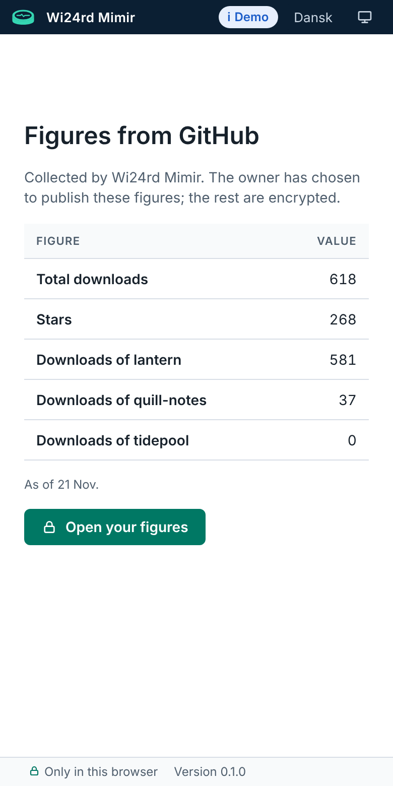
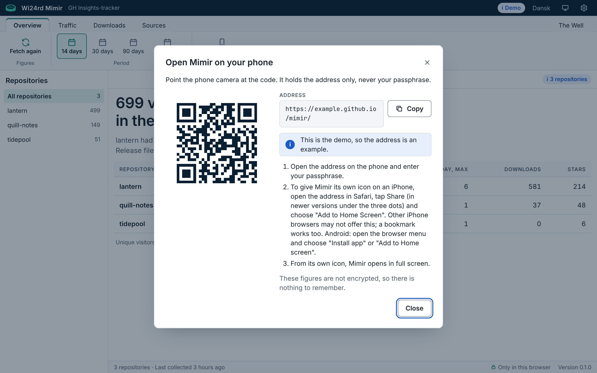

<h1>
  <picture>
    <source media="(prefers-color-scheme: dark)" srcset="assets/mimir-banner-dark.jpg">
    
  </picture>
</h1>

Keeps the history of your GitHub traffic and release downloads, in your own account.

GitHub shows repository traffic for the last 14 days only, and it does not show
how often a release file was downloaded. Mimir collects both twice a day with a
GitHub Actions workflow and stores them in a `data` branch of your own copy of
this repository. Nothing is sent to Wi24rd or to any third party.

**Status: first version, in daily use by its author.** Collection, setup, the
dashboard, GitHub Pages and the phone layout have been run for real. Not yet run
for real: the badges, the published Well, and creating a copy with "Use this
template". No release has been tagged. See [`asewave/`](asewave/) for what has
been verified and what has not.

<picture>
  <source media="(prefers-color-scheme: dark)" srcset="assets/screens/overview-dark.png">
  
</picture>

*Every picture on this page shows the demo with invented figures.*

**[Try the demo](https://wi24rd-com.github.io/mimir/?demo)** in your browser, or see
[the page a visitor meets](https://wi24rd-com.github.io/mimir/?demo=front). The
figures are invented and made in your browser; nothing is fetched.

## A look around

Mimir runs in a browser, on any computer and on a phone.

| The Well | One repository over time |
|---|---|
|  |  |
| The same figures as one picture, with the table beside it. | Views and clones per day, kept beyond GitHub's 14 days. |

| On a phone | What a visitor sees | Open on phone |
|---|---|---|
|  |  |  |
| Light and dark, English and Danish. | Only what you chose to publish. The rest is encrypted. | A QR code with the address, nothing else. |

## What it collects

| Figure | Source | What you get |
|---|---|---|
| Views and clones | Traffic API | One figure per day, kept beyond 14 days |
| Referrers and popular paths | Traffic API | GitHub's top 10 for the last 14 days, saved once per day |
| Release downloads | Releases API | The counter per file, saved when it changes |
| Stars, forks, watchers | Repository API | Saved when they change |

Unique visitors cannot be added up across days. GitHub only reports them per
day, and the same person on two days counts twice.

## Three modes

Set `visibility` in [`mimir.json`](mimir.json).

| Mode | Who can read the figures | Repository |
|---|---|---|
| `encrypted` (default) | Whoever has the passphrase | Public, content encrypted |
| `public` | Anyone | Public |
| `private` | You | Private |

In `encrypted` mode everything is stored as AES-256-GCM files. The key is
derived from your passphrase with PBKDF2-SHA256 (600,000 rounds). File names do
not reveal which repositories you track. What stays visible: that a tracker
exists, when it runs, and roughly how much data it holds.

Changing from an open mode to `encrypted` does not remove figures that are
already in the git history. Mimir refuses that change unless you ask for it.

## Access

Traffic figures require the "Administration: read" permission. The built-in
Actions token cannot have it. Instead of a long-lived personal access token,
setup registers a GitHub App that belongs to you, with that one read
permission. Each run asks for a token that expires after an hour.

## Setup

Requires [GitHub CLI](https://cli.github.com) and Node.js 20 or later.

1. Click **Use this template** at the top of this page and create your own
   repository from it. Make it public for the `encrypted` and `public` modes,
   private for `private`. Then clone it.
2. Edit `mimir.json`: your repositories and the mode. Commit and push.
3. Run `node src/setup.mjs` in the clone.

Use the template, not a fork. Each copy keeps its own figures in its own `data`
branch, and nothing is collected in a copy until setup has run there. A copy
does not follow this repository by itself; see [Updating](#updating).

You confirm twice in the browser: once to create the app, once to choose the
repositories it may read. The app's key goes straight into the repository's
secrets. It is not written to disk and not shown on screen. The app is named
after your account and the repository (`mimir-<account>-<repository>`), so a
second copy on the same account gets an app of its own.

## Updating

In your clone:

```
node src/update.mjs --check    # is there a newer version?
node src/update.mjs            # take the newest version
node src/update.mjs v1.2.0     # or a version you name
```

It fetches the version from this repository and replaces Mimir's own files:
`src/`, `docs/`, `test/`, `tools/` and the two workflows. Your `mimir.json`,
your README, your figures in the `data` branch and a custom domain file
(`docs/CNAME`) are not touched. Nothing is committed. You look at the change
(`git diff --cached --stat`), run `npm test`, and commit and push it yourself;
`git reset --hard` takes it back. A new major version is refused until you ask
for it with `--major`.

Versions are tagged releases of this repository. From 1.0.0, a newer 1.x
version reads the `mimir.json` and the `data` branch of an older one with
nothing for you to do. A test (`test/format.test.mjs`) holds files written by
0.1.0 to keep that promise.

## See your figures

In your clone:

```
node src/show.mjs          # a summary in the terminal
node src/dashboard.mjs     # the dashboard, served on this computer only
```

Both read the `data` branch of your clone. In `encrypted` mode they ask for your
passphrase; the dashboard decrypts in the browser and keeps the passphrase in
that tab's memory only. Add `--demo` to either command to try it with invented
figures, and `--lang da` for Danish in the terminal. `--front` shows the page a
visitor would meet on GitHub Pages.

The dashboard is in English and Danish, light and dark, and works on a phone.
It has four tabs with tables and charts (Overview, Traffic, Downloads, Sources),
a filter for one repository, and a fifth tab, The Well, that draws the same
figures as one picture: a stone per day around the rim and a point per
repository on the water. A settings dialog writes a
new `mimir.json` for you to save on GitHub. The page itself cannot change your
repository. It fetches from GitHub only: your figures, and, when nothing has
been collected for 36 hours, one question about whether the collecting workflow
is still switched on. Add `?demo` to the address on GitHub Pages for the demo.

It is built with [Wi24rd UI Kit 2](docs/kit/), the design system shared by the
Wi24rd programs, copied unchanged into `docs/kit/`.

## On your phone

Tried on GitHub Pages and in the browser on an iPhone, and in Chrome, Firefox
and WebKit (the engine in Safari) at desktop and phone size. Not tried: Android,
Safari itself, and "Add to Home Screen". See [`asewave/`](asewave/).

When the repository is public and GitHub Pages serves the `docs/` folder, the
dashboard has an address of its own. Turn it on under Settings, Pages: deploy
from the `main` branch, folder `/docs`. "Open on phone" in the dashboard shows a QR
code with that address and nothing else. On the phone, "Add to Home Screen"
(iPhone) or "Install app" (Android) gives Mimir its own icon and opens it in
full screen. It needs a connection; nothing is kept for offline use.

**What a visitor sees.** In `encrypted` mode a visitor meets a front page with
the figures you chose to publish, if any, and a button that leads to the lock.
Everything else stays encrypted. In `public` mode a visitor sees the whole
dashboard.

**Remember on this device.** Off unless you tick it on the lock screen. There
are two ways:

- *With a check*: Mimir creates a passkey on the device, and your passphrase is
  stored encrypted under a secret that the passkey only gives out after Face ID,
  a fingerprint or the device PIN. Not every phone and password manager can do
  this; Mimir says so and remembers nothing when they cannot.
- *Without a check*: the passphrase is stored encrypted under a key the browser
  will not hand out. Anyone holding the unlocked device can open the figures.

Either way, what is remembered belongs to the web address, not to Mimir. On
GitHub Pages every site of one account shares the address
`<account>.github.io`, so another Pages site of yours can reach it. Use it only
when the sites on that address are your own. "Forget this device" removes it; a
passkey stays in your password manager until you delete it there.

Browsers refuse passkeys on a numeric address. The local dashboard also answers
on `http://localhost:<port>/`, where they work.

## Badges and published figures

`public_badges` in `mimir.json` lists what is published in the open, in every
mode: `total_downloads`, `stars`, `repo_downloads` (one figure per repository)
and `well`. The first three are single figures with a badge each. `well` puts
The Well on the front page and publishes what it is drawn from: views per day,
and views, clones and downloads per repository, for the last 14 days. Those are
figures GitHub shows to the owner only, and once published they stay in the
history of the `data` branch. Visitors, referrers and pages are never published. Each collection
writes one small JSON file per figure to `badges/` on the `data` branch, removes
the files for figures you no longer list, and writes `public.json` for the front
page.

The settings dialog gives the Markdown and HTML for each badge, ready to paste
into a README. The picture is drawn by [shields.io](https://shields.io), a
service outside GitHub that reads the figure from your `data` branch; readers of
your README load the picture from there. The repository has to be public.

## Limits

- GitHub switches scheduled workflows off in a public repository after 60 days
  without activity, and Mimir commits to the `data` branch only. A workflow
  that is switched off cannot report it, so Mimir guards against it in three ways:
  - A small job switches the Collect workflow on again at every run, which is
    meant to keep GitHub from pausing it. This has not been proven over a full
    60 days.
  - After 45 days without a commit on the main branch, a collection opens one
    issue, "Mimir: GitHub may pause collection soon", so GitHub notifies you
    while there is time. It closes itself after the next commit.
  - When nothing has been collected for 36 hours, the dashboard and the
    terminal view ask GitHub whether the workflow was switched off, say so, and
    point to "Enable workflow". GitHub keeps traffic for 14 days, so no figures
    are lost when that is done within two weeks.
- Not tried on Android, in Safari itself, or as a home-screen app.
- A failed collection opens an issue in the repository. The next successful one closes it.
- Commits on the `data` branch carry the day only, not the time. The list of
  runs under Actions still shows when each collection ran.
- Solo-maintained in spare time. No support promise, no response times.

## Development

```
npm test
```

The same tests run on GitHub at every push to the main branch (`.github/workflows/test.yml`).

No dependencies. Built with [ASEWAVE](https://asewave.org).

## License

Apache License 2.0. See [`LICENSE`](LICENSE) and [`NOTICE`](NOTICE). The fonts in
`docs/kit/fonts/` are under the SIL Open Font License 1.1.
